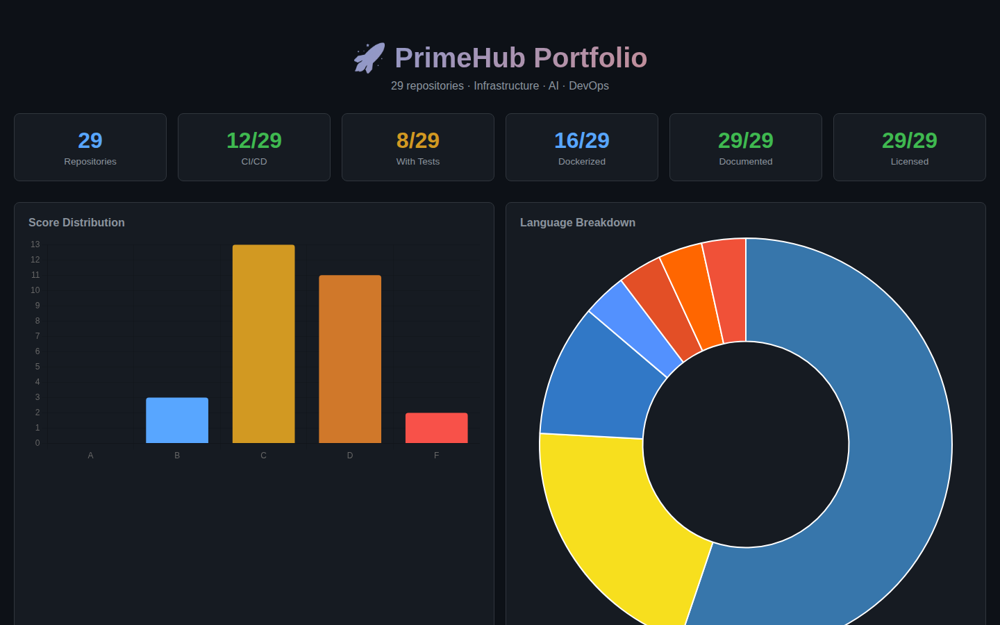
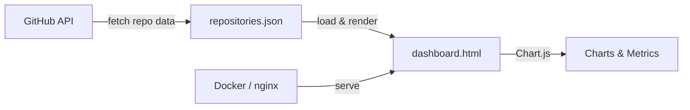
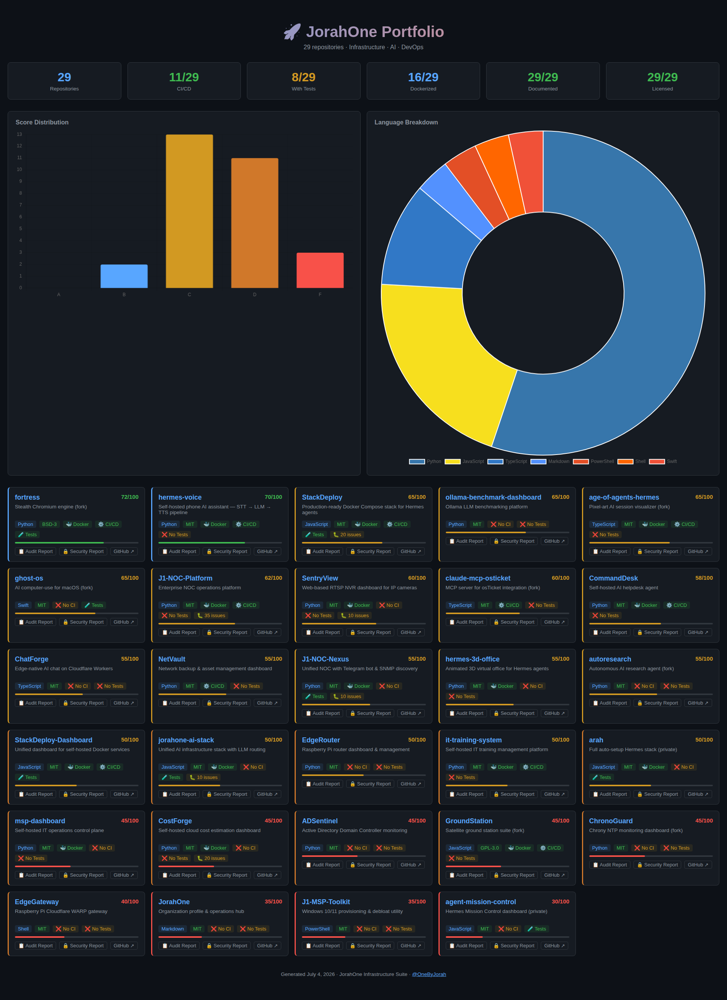
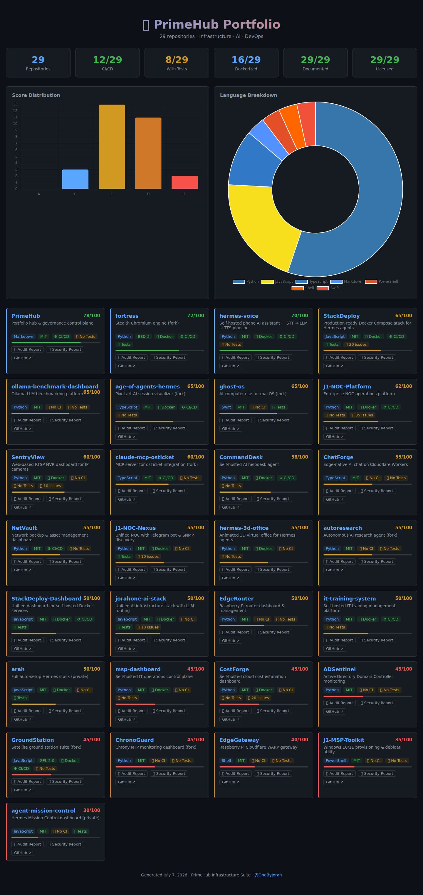
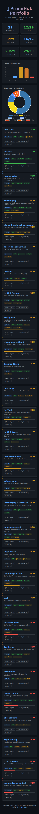

<div align="center">


# PrimeHub

**A single dashboard for the entire OneByJorah infra portfolio** — repo activity, language mix, health signals, and standardization status at a glance.

<a href="https://github.com/OneByJorah/PrimeHub/stargazers"></a>
<a href="https://github.com/OneByJorah/PrimeHub/commits"></a>
<a href="LICENSE"></a>


</div>



## What This Is

With dozens of repositories across AI, networking, and ops, it is hard to see the whole picture from GitHub's org page. PrimeHub renders the portfolio from a cached GitHub API snapshot — star counts, language breakdowns, activity, and health indicators — in a zero-backend static dashboard you can host anywhere.

## Quick Start

```bash
git clone https://github.com/OneByJorah/PrimeHub.git
cd PrimeHub
docker compose up -d
```

Open **http://localhost:8080**.

### Local serve

```bash
python -m http.server 8080   # or: npx serve .
```

## Features

- **Portfolio overview** — aggregated stats for every repo in `repositories.json` (29 in the current snapshot).
- **Health scoring** — automatic assessments based on activity, docs, CI, and community signals.
- **Language breakdown** — visual distribution of programming languages across projects.
- **Trend tracking** — star history, commit frequency, and contribution patterns.
- **Zero-dependency frontend** — pure HTML/CSS/JS with Chart.js; no build step or backend.
- **Docker-ready** — ships an `nginx:alpine` image for local or cloud deployment.
- **Installer scripts** — `install.sh` (Docker or local serve) and `install.ps1` (Windows).

## Architecture



> [!NOTE]
> `dashboard.html` is copied to `index.html` inside the container by the Dockerfile, so the dashboard is the site root.

## Configuration

| Variable | Default | Description |
|----------|---------|-------------|
| `PORT`   | `8080`  | Host port mapped to nginx inside the container |

```bash
PORT=3000 docker compose up -d
```

No other environment variables are required — this is a static site.

## Data Source

`repositories.json` is a cached snapshot of the [OneByJorah GitHub profile](https://github.com/OneByJorah). Refresh it with:

```bash
curl -s "https://api.github.com/users/OneByJorah/repos?per_page=100" > repositories.json
```

## Project Structure

```
PrimeHub/
├── dashboard.html          # Main dashboard entry point (Chart.js)
├── repositories.json       # Cached snapshot of OneByJorah repos
├── Dockerfile              # nginx:alpine image (dashboard.html → index.html)
├── docker-compose.yml      # Single-service compose config
├── install.sh              # Bash installer (Docker or local serve)
├── install.ps1             # PowerShell installer
├── docs/                   # Banner, screenshots
├── INTENT.md               # Deep portfolio analysis & roadmap
└── LICENSE                 # MIT
```

## Use Cases

1. **Org health review** — spot stale repos, missing docs, or CI gaps across the portfolio.
2. **Showcase page** — a shareable overview of everything OneByJorah builds.
3. **Standardization tracking** — compare repos against shared conventions at a glance.

## Tech Stack

HTML5 · CSS · JavaScript · Chart.js · GitHub REST API · nginx · Docker · Docker Compose

## Screenshots

| View | |
|---|---|
|  |  |
|  |  |

## Contributing

Contributions are welcome. Please read [CONTRIBUTING.md](CONTRIBUTING.md) before submitting a PR. [Open an issue](https://github.com/OneByJorah/PrimeHub/issues).

## License

MIT — see [LICENSE](LICENSE).

## Connect

- [jorahone.com](https://jorahone.com)
- [GitHub Org](https://github.com/OneByJorah)
- [info@jorahone.com](mailto:info@jorahone.com)
