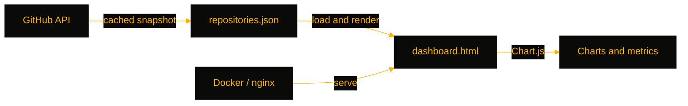

# PrimeHub

> A zero-backend static dashboard that renders the entire OneByJorah repo portfolio — activity, language mix, and health signals — from a cached GitHub API snapshot.

[](https://github.com/OneByJorah/PrimeHub)
[](https://github.com/OneByJorah/PrimeHub)
[](https://github.com/OneByJorah/PrimeHub/stargazers)
[](https://github.com/OneByJorah/PrimeHub/commits)


## What This Is

With dozens of repositories across AI, networking, and ops, GitHub's org page stops being a useful overview. PrimeHub renders the portfolio from `repositories.json` — star counts, language breakdowns, activity, and health indicators — in a single static page you can host anywhere. Built for portfolio review, showcase pages, and standardization tracking.

## Quick Start

```bash
git clone https://github.com/OneByJorah/PrimeHub.git
cd PrimeHub
docker compose up -d
```

Open `http://localhost:8080`. Or serve locally with `python -m http.server 8080`.

## Features

- Portfolio overview for every repo in `repositories.json` (29 in the current snapshot)
- Health scoring based on activity, docs, CI, and community signals
- Language distribution charts across all projects
- Star history, commit frequency, and contribution trend views
- Pure HTML/CSS/JS with Chart.js — no build step or backend
- nginx:alpine Docker image for one-command deployment
- `install.sh` and `install.ps1` for Docker or local-serve setup

## Architecture



Refresh the data with `curl -s "https://api.github.com/users/OneByJorah/repos?per_page=100" > repositories.json`.

## Stack

HTML5, CSS, JavaScript, Chart.js, GitHub REST API, nginx, Docker Compose

## Contributing

Contributions are welcome — read [CONTRIBUTING.md](CONTRIBUTING.md) and [open an issue](https://github.com/OneByJorah/PrimeHub/issues).

## License

MIT — see [LICENSE](LICENSE).
