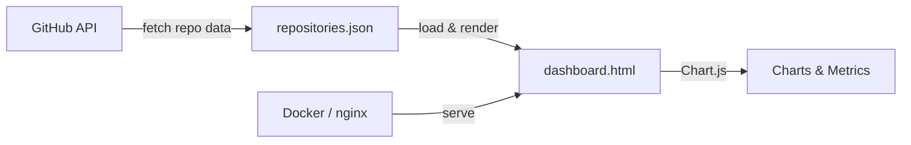

# PrimeHub

A unified dashboard that surfaces all OneByJorah GitHub repositories in one place — star counts, language breakdowns, health scores, and trend data — so you can monitor your entire portfolio at a glance.

## Key Features

- 📊 **Real-time portfolio overview** — aggregated stats across all 29 OneByJorah repos
- 🔍 **Repository health scoring** — automated assessments based on activity, docs, CI, and community signals
- 📈 **Trend tracking** — star history, commit frequency, and contribution patterns over time
- 🌐 **Language breakdown** — visual distribution of programming languages across projects
- 🚀 **Zero-dependency static site** — pure HTML/CSS/JS with Chart.js, no backend required
- 🐳 **Docker-ready** — ship with nginx for instant local or cloud deployment

## Quick Start

### Prerequisites

- [Docker](https://docs.docker.com/get-docker/) and Docker Compose
- Or a modern web browser (for local file serving)

### Option 1 — Docker (Recommended)

```bash
git clone https://github.com/OneByJorah/PrimeHub.git
cd PrimeHub

# Create your environment file
cp .env.example .env

# Launch the dashboard
docker compose up -d
```

Open [http://localhost:8080](http://localhost:8080) in your browser.

### Option 2 — Local Serve

```bash
git clone https://github.com/OneByJorah/PrimeHub.git
cd PrimeHub

# Using Python
python -m http.server 8080

# Or using Node
npx serve .
```

## Architecture

```
PrimeHub/
├── dashboard.html          # Main dashboard entry point (Chart.js)
├── repositories.json       # Snapshot of all OneByJorah repos from GitHub API
├── Dockerfile              # nginx:alpine container image
├── docker-compose.yml      # Single-service compose config
├── install.sh              # Bash installer (Docker or local serve)
├── install.ps1             # PowerShell installer (Docker or local serve)
├── CONTRIBUTING.md         # Contribution guidelines
├── INTENT.md               # Deep portfolio analysis & roadmap
└── LICENSE                 # MIT
```



## Configuration

| Variable | Default | Description |
|----------|---------|-------------|
| `PORT`   | `8080`  | Host port mapped to nginx inside the container |

Set via `.env` file or export directly:

```bash
PORT=3000 docker compose up -d
```

## Data Source

`repositories.json` is a cached snapshot of the [OneByJorah GitHub profile](https://github.com/OneByJorah). To refresh, run:

```bash
curl -s "https://api.github.com/users/OneByJorah/repos?per_page=100" > repositories.json
```

## Contributing

Contributions are welcome! Please read [CONTRIBUTING.md](CONTRIBUTING.md) before submitting a pull request.

## License

This project is licensed under the MIT License — see [LICENSE](LICENSE) for details.

Copyright (c) 2026 Jhonattan L. Jimenez · [JorahOne Networks](https://jorahtech.com)
